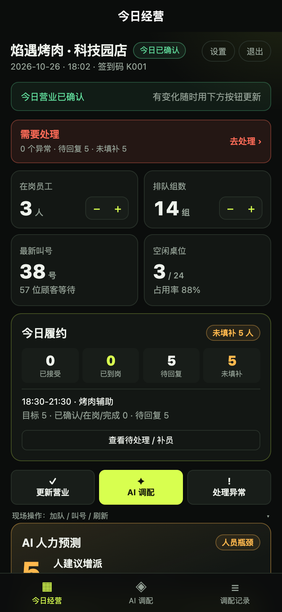
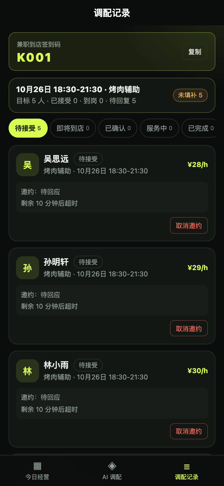
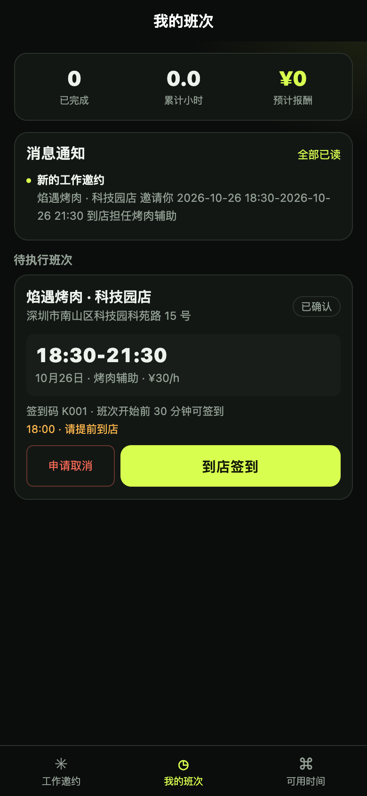
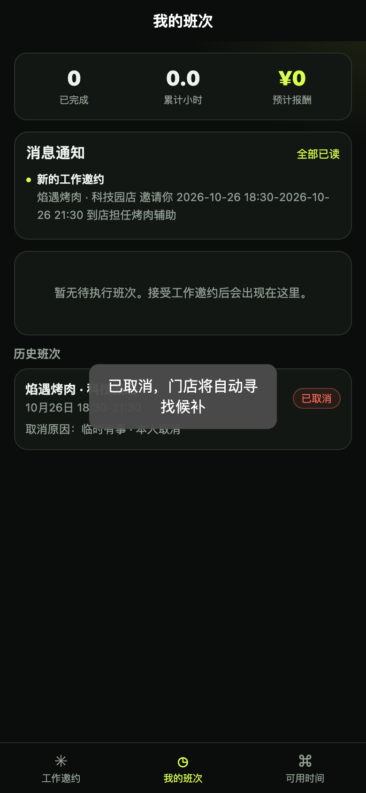
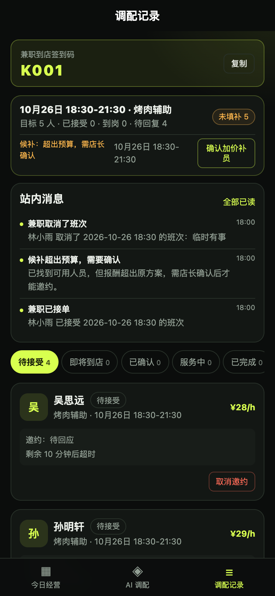
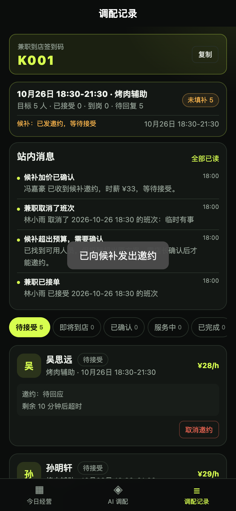
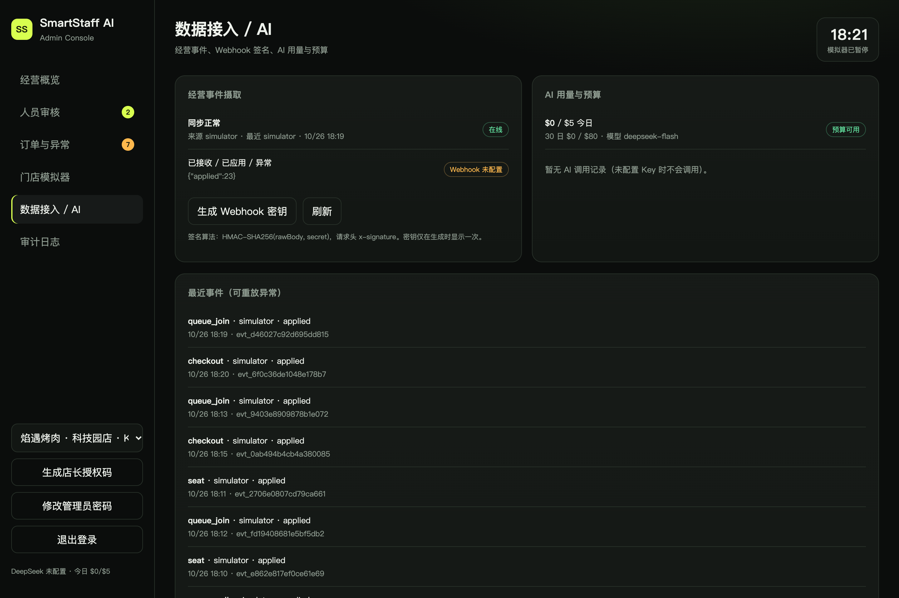
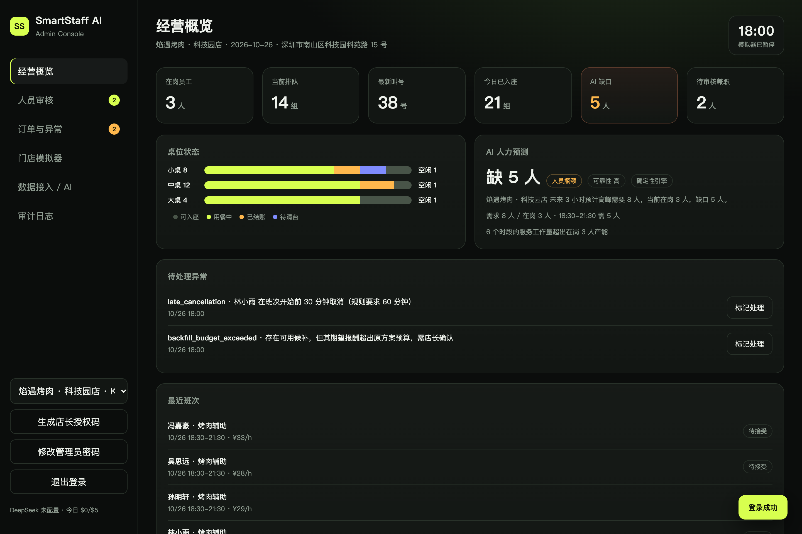
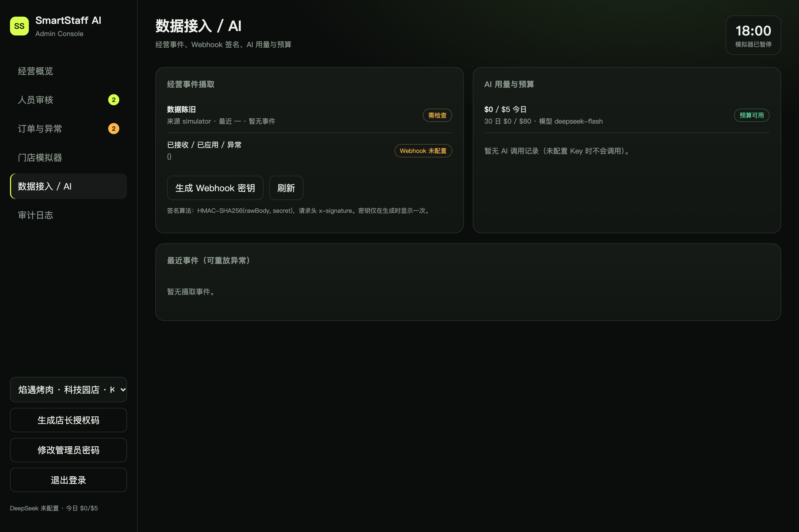
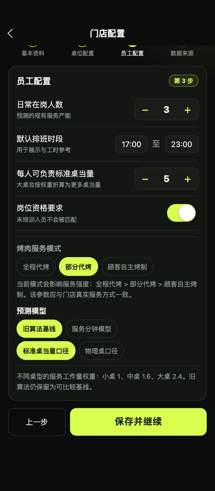

# SmartStaff AI · R2 验收报告

> 日期：2026-10-26  
> 范围：R2.1 身份与安全 → R2.2 取消与自动候补 → R2.3 服务模式与工作量模型 → R2.4 统一事件摄取 → R2.5 AI 治理 → 首页三操作 UX  
> 结论：**内部可验收（演示/测试环境）**。69/69 自动化测试通过；H5/后台浏览器链路通过。真实微信、短信、POS 与真实 DeepSeek 成功调用因缺少外部凭据**未验证**，系统在这些路径上明确阻塞，未伪造成功。

---

## 1. 结论先行

| 项目 | 结果 |
| --- | --- |
| 原有 R1 测试 | 37/37 通过（其中 2 条断言按 R2 新行为更新，见 §8.3） |
| R2 新增测试 | 32/32 通过 |
| 合计 | **69/69 通过**，0 skipped，0 todo |
| 真实微信登录 | **未验证 / 阻塞**：无 AppID/Secret，接口返回 `503 WECHAT_NOT_CONFIGURED` |
| 真实短信验证 | **未验证 / 阻塞**：无 SMS Provider，返回 `503 SMS_NOT_CONFIGURED` |
| 真实 POS | **未接入，也未声称接入**：提供通用 HMAC Webhook；模拟器/人工为适配器 |
| 真实 DeepSeek 成功 | **未验证**：真实 HTTPS 请求返回 401，`AI_AUTH_FAILED`；没有把 Mock 当验收 |
| 服务分钟模型 | 已实现并与旧算法对比；参数**未用真实门店记录校准**，默认仍保留旧算法基线 |
| 浏览器 UI | 店长首页/记录、兼职取消、管理员数据接入均通过；无 console error |
| 生产就绪 | **否**。演示/内测可，真实上线前须解决 §9 的阻塞项 |

**一句话**：R2 的功能与安全增量已经落地并通过内部测试；所有需要外部凭据、真实历史工作记录或真实 POS 的结论，本报告一律标记为未验证，不用模拟结果替代。

---

## 2. 复现方式

```bash
cd SmartStaff-AI/apps/server
npm test                         # 69/69
npx tsx scripts/r2-deepseek-check.ts
npx tsx scripts/r2-service-check.ts
```

演示：

```bash
cd SmartStaff-AI
npm run setup
npm run dev
# H5:    http://127.0.0.1:8787/app/
# Admin: http://127.0.0.1:8787/admin/
```

开发 `.env` 显式开启演示登录；生产默认关闭。真实凭据配置见 README 与 `.env.example`。

---

## 3. R2.1 身份、安全与会话

### 3.1 已实现

| 要求 | 实现 | 证据 |
| --- | --- | --- |
| 微信 `code2Session` | `lib/wechat.ts` 调用官方 `jscode2session`；无 AppID/Secret 返回 503，无 Mock | `r2-security.test.ts` · WeChat 503 |
| OpenID 绑定 | `users.openid`；同一 OpenID 不允许跨角色；兼职手机号已绑定其他微信时拒绝；店长授权码一次性 | 2 项 Mock `code2Session` 绑定测试；真实微信未验证 |
| 店长门店绑定 | 一次性授权码 `manager_claim`（哈希、24h 过期、消费一次）；`owner_user_id` | 一次性绑定/重放测试 |
| 兼职手机号核验 | 自助登记只创建 `pending`、`phone_verified=0`；管理员核验后微信登录才放行 | 登记/核验测试 |
| 管理员强密码 | 长度/字符/常见密码校验；生产启动拒绝弱/默认密码 | 生产安全测试 |
| 管理员登录限流 | 5 次 / 15 分钟，按 IP + 服务实例 | 第 6 次 429 测试 |
| 移除生产默认密码 | `.env.example` 无默认管理员密码；`assertProductionSafety` 拒绝弱/空密码 | 配置测试 |
| CORS | 仅回显白名单 Origin；非白名单预检 403；禁止 `*` | CORS 测试 |
| HTTPS | 生产强制 HTTPS；`/health` 例外；反代需 `TRUST_PROXY` | HTTPS 426 测试 |
| Token 过期/刷新/撤销 | Access 120min、Refresh 30d；refresh 轮换；logout/logout-all 撤销；服务端只存哈希 | 过期/轮换/撤销测试 |
| 敏感操作复验 | 审核、模拟器、推进、建员工、异常、核验手机号、授权码等要求 15 分钟内登录 | 敏感操作测试 |
| 密钥脱敏 | DeepSeek 上游错误只回稳定错误码；Key/request_id 不入客户端响应 | AI 脱敏测试 |
| 演示账号 | 默认关闭；仅非生产 + `ALLOW_DEMO_LOGIN=true` + 回环地址；生产校验拒绝 | 默认关闭/生产拒绝测试 |

### 3.2 关键文件

- `apps/server/src/config.ts`、`lib/auth.ts`、`lib/managerClaim.ts`、`lib/wechat.ts`、`lib/rateLimit.ts`
- `lib/http.ts`（CORS/HTTPS/安全头/rawBody）
- `routes/auth.ts`、`routes/admin.ts`
- `tests/r2-wx-binding.test.ts`（Mock 传输，仅验证绑定逻辑）
- `apps/miniapp/src/api/client.ts`（access + refresh 自动重试）
- `apps/admin/app.js`（refresh、改密、授权码、手机号核验）
- `tests/r2-security.test.ts`

### 3.3 验证结果

13 项 R2 安全测试全部通过；另有 2 项用 Mock 的 `code2Session` 传输验证 OpenID 绑定/一号一微信/店长授权码一次性，但**不构成真实微信验收**。真实微信/短信路径仅验证了**未配置时的阻塞**。

---

## 4. R2.2 取消、缺岗与自动候补

### 4.1 状态机

```text
plan confirmed
  -> staffing_demands (plan + slot + role; headcount / rate cap)
  -> shifts invited -> confirmed -> checked_in -> completed
                    \-> cancelled / no_show
  -> backfill_tasks (per source shift; pending/offered/filled/no_candidate/needs_approval/cancelled)

staff cancel (before start) ─┐
manager cancel person ───────┼─> committed drops ─> shortfall
no-show after grace ─────────┘                     -> auto match
                                                   -> offer (within budget)
                                                   -> staff must accept
                                                   -> filled
over budget -> needs_approval -> manager approve -> offer
no candidate / too late -> explicit exception + uncovered gap
whole-demand cancel -> all active shifts cancelled; NO backfill
```

### 4.2 已实现规则

- 兼职只能取消**本人已确认且未开始**的班次；已开始/已取消/待接受邀约走不同错误。
- 店长取消支持 `scope='person'`（自动候补）与 `scope='demand'`（取消整个需求，不补人）；需求内有人已签到则拒绝整单取消。
- 确认班次被取消、或超过宽限期缺岗后，才触发候补；待接受邀约被店长取消不触发。
- 候补时间从 `max(demand.start, now + minNotice)` 开始，按 5 分钟向上取整；剩余不足 20 分钟不自动候补，升级人工异常。
- 候选排除：本次取消/缺岗者、同需求历史已取消者、已拒绝/超时/取消的候选；发出邀约前重新校验可用性/冲突。
- 预算内自动发邀约；超出原需求时薪上限不静默派单，任务置 `needs_approval` 并生成 `backfill_budget_exceeded` 异常；店长确认后才发邀约，且仍须本人接受。
- 需求人数/岗位/时段固定；多人在途缺口按 shortfall 创建多个任务，不会因一个 task 阻塞全部补员。
- 取消/缺岗时把该班次 `pending|accepted` 邀约改为 `cancelled`，不保留 `accepted` 终态。
- 计数：`committed = confirmed + checked_in + completed`；`pending = invited`；`unfilled = headcount - committed`；`uncovered = headcount - committed - pending`。
- 所有写操作使用事务/条件更新；重复取消返回冲突，一个 source shift 只创建一个 backfill task。

### 4.3 关键文件

- `domain/dispatch.ts`：`createDemand`、`triggerBackfillForShift`、`staffCancelShift`、`managerCancelShift`、`managerCancelDemand`、`approveBackfillTask`、`markBackfillFilled`、`reconcileDemand`
- `domain/plans.ts`：确认方案时按 plan+slot+role 建需求
- `domain/ops.ts` / `routes/manager.ts`：today coverage、scope 取消、backfill 审批
- `routes/staff.ts`：`POST /api/staff/shifts/:id/cancel`
- UI：`manager/home.vue`、`manager/records.vue`、`staff/shifts.vue`

### 4.4 测试

6 项 R2 候补测试通过：

- 需求/覆盖计数；
- 兼职自助取消 → 产生 replacement offer → replacement 必须接受 → task filled；
- 店长按人取消/按需求取消；
- 缺岗后按剩余时间补员；
- 无候选 + 重复取消幂等；
- 超预算需店长确认，确认后邀约且 committed 仍为 0。

浏览器验证：兼职取消后历史班次显示“已取消/本人取消”；店长记录显示“候补：超出预算，需店长确认”与“确认加价补员”。

---

## 5. R2.3 服务模式与工作量模型

### 5.1 语义修复

新增 `store.config.staffing`：

```jsonc
{
  "capacityModel": "legacy",                 // legacy | service_minutes
  "capacityBasis": "standard_equivalent",    // standard_equivalent | physical_tables
  "serviceMode": "partial",                  // full | partial | self
  "serviceMinutes": { "small": 14, "medium": 26, "large": 44 },
  "effectiveServiceMinutesPerSlot": 24,
  "calibrationStatus": "unverified"
}
```

- `tablesPerStaff` 不再含混：UI 明确写“每人可负责标准桌当量/物理桌数”，`capacityBasis` 决定旧算法按加权当量还是真实桌数。
- 服务模式影响：旧算法用容量系数（全程/部分/自主），分钟模型用服务强度系数（1.55/1.0/0.55）。
- 旧算法保留为可比较基线，默认仍为 `legacy`，避免破坏已有经营口径与 37 项基线。
- 分钟模型公式：

```text
attention = Σ occupied[type] × serviceMinutes[type] × intensity × (30 / (avgDining + checkout + clean))
queue     = queueGroups × 2 min
cleaning  = freeingTables × (checkout + clean) × intensity × 0.5
workload  = attention + queue + cleaning
required  = ceil(workload / effectiveMinutesPerSlot × (1 + buffer%))
```

输出每个 slot 的 `workloadMinutes` 与 `capacityMinutes`；未校准的 `service_minutes` 可靠性最多 `medium`，并返回 `modelWarning`。**没有把模拟参数称为真实校准。**

新增“真实样本校准”工作流：管理员通过 `/api/admin/stores/:id/service-calibration` 提交 ≥30 个真实样本、证据说明与参数，写入 `service_calibrations` 后才可把 `calibrationStatus` 置为 `calibrated`；店长配置接口若没有匹配证据或把模型改回 legacy，直接返回 `CALIBRATION_EVIDENCE_REQUIRED`。

### 5.2 对比证据

场景：R1 标准场景（24 桌 / 3 在岗 / 14 组排队 / 7 天历史）。完整数据见 `docs/r2-evidence/service-model-comparison.json`。

| 模式 | 峰值需求 | 峰值缺口 | 每 30 分钟需求 |
| --- | ---: | ---: | --- |
| 旧算法·标准桌当量 | 8 | 5 | 8,8,7,8,8,7 |
| 旧算法·物理桌 | 6 | 3 | 6,5,4,5,5,5 |
| 分钟模型·全程代烤 | 18 | 15 | 18,15,11,15,14,15 |
| 分钟模型·部分代烤 | 12 | 9 | 12,10,7,10,9,10 |
| 分钟模型·自主烤制 | 7 | 4 | 7,6,4,6,5,6 |

> 分钟模型明显高于旧算法，原因是它把每桌服务分钟、清台与有效工作分钟显式计入；这些参数尚未用门店真实工时校准。该差异是**待校准的经营假设**，不是已验证的真实需求。

### 5.3 测试

4 项服务模型测试：旧基线/物理桌/分钟模型区分、三模式单调、提高服务分钟会提高需求，以及“前端不能自行标记已校准”。UI 设置页已增加服务模式、模型、桌数口径、服务分钟与未校准提示。

---

## 6. R2.4 统一事件摄取

### 6.1 架构

```text
manual command ─┐
webhook (HMAC) ─┼─> ingestEvent ─> event_ingest (unique external id)
simulator ──────┘        │                │
                         │                ├─ duplicate -> no state change
                         │                ├─ stale (>5 min behind) -> record, no apply
                         │                ├─ future (>10 min ahead) -> record error
                         │                └─ apply -> ops state / shift attendance
                         └─> exception + audit + replay/correction trace
```

新增表：

- `event_ingest`：source、external_id、event_type、occurred_at、received_at、payload、status、error、signature_valid、correction_of、applied_event_id
- `event_ingest_state`：last_received_at / last_applied_at / last_event_at / last_source
- `stores.webhook_secret`

支持事件：`queue_join`、`queue_call`、`queue_abandon`、`seat`、`checkout`、`leave`、`clean`、`staff_checkin`、`staff_checkout`。

### 6.2 语义

- `POST /api/ingest/webhook/:storeCode`，`x-signature: sha256=HMAC_SHA256(rawBody, secret)`；未配置密钥 503，签名错误 401，门店编码不存在 404。
- `(store_id, source, external_id)` 唯一；重复事件返回 `duplicate`，状态只更新一次。
- 早于最近已应用事件 5 分钟标记 `stale`，保留记录但不应用；事件时间超前门店时钟 10 分钟拒绝。
- 应用失败写 `error` + `ingest_error` 异常；管理员可按 id 重放。
- 修正/重放追加新事件并写 `correction_of`，原事件保留；没有“修改历史事件”的接口。
- 店长首页与管理员数据页显示最近事件、已应用/异常、数据陈旧提示；管理员可生成/轮换 Webhook 密钥。
- 没有假装接入真实 POS；Webhook 是通用适配器，模拟器与人工是内置适配器。

### 6.3 已知偏差（重要）

- **manual/webhook 严格先写 `event_ingest` 再更新经营状态**。
- **simulator 是内部可信适配器**：其状态转换先发生，随后在同一同步路径把事件镜像到 `event_ingest`。因此“所有事件严格先进入摄取层”在模拟器路径上不是理论严格顺序；外部/manual 路径满足。该偏差已保留在账本与审计中，未用文案掩盖。
- 生产环境应把模拟器关闭或仅用于沙盒；`dataSource` 会标记来源。

### 6.4 测试

5 项 R2 摄取测试：签名 + 幂等、坏签名/缺密钥/错门店、陈旧事件 + manual 同账本、修正 + 重放、轮换密钥使旧签名失效。模拟器测试断言其事件也进入账本（23 条 applied，见截图）。

---

## 7. R2.5 AI 治理

### 7.1 已实现

- 只有真实上游返回合法 JSON 且通过 schema 才 `aiStatus='ok'`；任何异常降级为确定性解释。
- `ai_usage` 记录：模型、prompt/completion/total tokens、延迟、估算成本、成本口径、状态、错误码、缓存命中。
- 单店日预算 + 全平台 30 日预算；超出不调用，记录 `budget_blocked`，生成异常/审计。
- 同一经营事实 + 模型在 TTL 内复用缓存，避免重复推理。
- 上游错误只返回稳定代码（`AI_AUTH_FAILED` / `AI_TIMEOUT` / `AI_UPSTREAM_ERROR` / `AI_RESPONSE_INVALID` / `AI_NOT_CONFIGURED`）；详细响应只写日志。
- 未配置 Key 返回 `AI_NOT_CONFIGURED`，不调用、不伪造成功。

### 7.2 真实请求结果

证据：`docs/r2-evidence/deepseek-real-request.json`

| 项目 | 结果 |
| --- | --- |
| Endpoint | `https://api.deepseek.com/chat/completions` |
| Model | `deepseek-flash` |
| 请求 | 已发出（真实 HTTPS） |
| 结果 | HTTP 401，`AI_AUTH_FAILED` |
| 延迟 | 约 128 ms |
| 返回 JSON / token / 成本 | **未验证** |
| 无 Key | `AI_NOT_CONFIGURED`，未发请求 |
| Mock 测试 | 6 项 AI 测试通过，但**不计作真实 API 验收** |

---

## 8. 首页 UX 与跨阶段门禁

### 8.1 首页信息

- 当前营业状态、在岗/排队/叫号/空闲桌；
- 未来 3 小时预测、建议增派、可靠性、瓶颈；
- 已接受 / 已到岗 / 待回复 / 未填补；
- 异常优先红色条；
- 仅 3 个主操作：**更新营业 / AI 调配 / 处理异常**；加队、叫号、刷新收进“现场操作”次级入口。

### 8.2 门禁场景

| # | 场景 | 结果 | 证据 |
| ---: | --- | --- | --- |
| 1 | 微信未配置不得伪造登录 | 503 | r2-security |
| 2 | 演示登录默认关闭/生产拒绝 | 通过 | r2-security |
| 3 | Token 过期、refresh 轮换、logout 撤销、敏感复验 | 通过 | r2-security |
| 4 | 兼职自助取消 → 自动候补 → 本人接受 | 通过 | r2-backfill |
| 5 | 店长按需求取消 → 不补人 | 通过 | r2-backfill |
| 6 | 缺岗后按剩余时间补员 | 通过 | r2-backfill |
| 7 | 超预算必须店长确认，不能静默派单 | 通过 | r2-backfill |
| 8 | Webhook 签名/幂等/陈旧/修正/重放 | 通过 | r2-ingest |
| 9 | 三种服务模式需求单调、未校准提示 | 通过 | r2-service |
| 10 | AI 用量/预算/缓存/降级/无 Key | 通过（Mock） | r2-ai |
| 11 | 被取消/缺岗班次不残留 accepted | 通过 | r2-backfill / R1 更新断言 |

### 8.3 对 R1 断言的更新（未跳过）

两条 R1 测试因 R2 行为改变而更新，仍执行且通过：

1. “staff cannot cancel themselves” → 改为验证取消路由存在；对已取消班次返回 409，不再期望 404。
2. “accepted offer remains accepted after cancellation/no-show” → 改为期望 accepted 数 = 0；这是 R2 的修复目标。

没有删除测试、没有跳过、没有降低断言强度。

---

## 9. 未解决 / 未验证（必须披露）

| # | 项目 | 状态 | 影响 | 建议 |
| ---: | --- | --- | --- | --- |
| 1 | 真实微信登录/OpenID 绑定 | 未验证 | 无法证明真实小程序登录 | 配置 AppID/Secret，在微信开发者工具与真机跑 `wx.login` |
| 2 | 真实短信验证 | 未验证 | 手机号核验目前依赖管理员 | 接入短信服务商并验证码限流/防刷 |
| 3 | 真实 POS | 未接入 | 事件来源只有模拟器/人工/通用 Webhook | 与具体 POS 厂商做字段映射、签名与回放演练；不伪造 |
| 4 | 真实 DeepSeek 成功 | 未验证（401） | 无法证明真实模型 JSON/token/成本 | 提供有效 Key 后重跑 `r2-deepseek-check.ts`，以真实 usage 记账 |
| 5 | 服务分钟参数校准 | 无真实数据 | 分钟模型可能高估/低估需求；已实现证据强制工作流，但演示库仍为 `unverified` | 用真实门店服务工时、桌型、翻台记录做回测并走管理员校准接口；不得用模拟数据标记 calibrated |
| 6 | 模拟器“严格先入摄取层” | 部分偏差 | 与理论架构描述不完全一致 | 生产禁用模拟器；或重构成 simulator 也先写 event_ingest 再变更状态 |
| 7 | Webhook 密钥静态存储 | 未加密 | 数据库泄露可伪造事件 | 生产使用 KMS/加密列或外部 secret manager；当前仅 SQLite 文件权限保护 |
| 8 | 限流为单进程内存 | 已知 | 多实例部署限流不共享 | 生产接 Redis/网关限流 |
| 9 | 店长数据修正无 UI | 仅 API | 店长需通过人工操作/API | 增加事件列表与“追加修正”入口；当前管理员可重放 |
| 10 | 兼职自助登记无 UI | 仅 API | 生产需门店/管理端发起 | 小程序增加登记表单并接短信/管理员核验 |
| 11 | 微信小程序未真机运行 | 仅构建 | 未验证微信运行时 API | 用微信开发者工具导入 `dist/build/mp-weixin` 真机验收 |
| 12 | 多进程并发 | 单进程测试 | SQLite 写锁/多实例未验证 | 生产迁移 PostgreSQL 或单写队列 |
| 13 | AI 成本价 | 配置估算 | 非账单核对值 | 用供应商账单校准 `DEEPSEEK_*_PRICE_PER_MTOK` |

---

## 10. Schema 与 API 增量

### 10.1 Schema

`SCHEMA_VERSION = 6`。新增/扩展：

- `users`：`openid`、`phone_verified`
- `sessions`：`refresh_token_hash`、`access_expires_at`、`refresh_expires_at`、`last_auth_at`
- `stores`：`owner_user_id`、`manager_claim_hash`、`manager_claim_expires_at`、`webhook_secret`
- `shifts`：`demand_id`、`is_backfill`、`cancelled_at/by/reason/kind`
- 新表：`staffing_demands`、`backfill_tasks`、`phone_verifications`、`event_ingest`、`event_ingest_state`、`ai_usage`、`ai_cache`、`service_calibrations`

迁移使用 `PRAGMA table_info` + `ALTER TABLE` 的增量方式，旧库可启动。

### 10.2 新增 API（摘要）

- 认证：`/auth/config`、`/auth/wx-login`、`/auth/staff/register`、`/auth/refresh`、`/auth/logout-all`、`/auth/admin/change-password`、`/auth/phone/code`、`/auth/phone/verify`、`/auth/manager/claim-code`
- 店长：`/manager/assignments/:id/cancel`（scope）、`/manager/backfill/:id/approve`、`/manager/ingest/status`、`/manager/ingest/events`、`/manager/ingest/:id/correct`
- 兼职：`/staff/shifts/:id/cancel`
- 管理员：`/admin/stores/:id/service-calibration`、`/admin/stores/:id/service-calibrations`、`/admin/ingest/status`、`/admin/ingest/events`、`/admin/ingest/:id/replay`、`/admin/stores/:id/webhook-secret`、`/admin/ai-usage`
- 公共 Webhook：`/api/ingest/webhook/:storeCode`

详见 `docs/API.md`。

---

## 11. 浏览器证据

| 截图 | 内容 |
| --- | --- |
|  | 首页三主操作、履约计数、风险条 |
|  | 需求计数、邀约状态 |
|  | 兼职班次“申请取消” |
|  | 已取消/本人取消 |
|  | 超预算候补需店长确认 |
|  | 确认后发邀约 |
|  | 23 条 simulator 事件入账、同步正常 |
|  | 后台总览、异常、AI 缺口 |
|  | AI 用量/预算空状态（无 Key，不伪造） |
|  | 三种服务模式、模型与桌数口径 |

浏览器日志：`docs/r2-evidence/browser-e2e.json`（0 console error；个别网络等待曾超时，定位为 Playwright 全页截图/选择器问题，不影响页面；后续拆分脚本完成）。

---

## 12. 主要修复的缺陷

1. `/api/me` 泄露 sessionId（token 哈希）→ 公开用户字段白名单。
2. 取消/缺岗后 `job_offers` 仍保留 `accepted` → 统一改为 `cancelled`。
3. 短 access token 过期时 `resolveSession` 删除会话，refresh 无法使用 → 保留 refresh。
4. forecast 起始时段只取下一个半点，临近 `minNotice` 时预测有缺口但方案 0 人 → 起始时段改为 `max(now+1min, now+minNotice)` 后向上取整。
5. 超预算候补只有异常没有审批入口 → 新增 `approveBackfillTask` 与 UI。
6. 多个取消只允许一个在途候补 → 按 shortfall 允许多个任务。
7. 管理员登录弱密码返回泛化 VALIDATION_ERROR → 保留强密码专用错误。
8. 同手机号可被多个 OpenID 重新绑定 → 增加 `OPENID_ALREADY_BOUND`。
9. 模拟器事件未进入统一账本 → 镜像写入 `event_ingest`（仍非严格先写，见 §6.3）。

---

## 13. 生产前必须完成

- [ ] 配置真实微信 AppID/Secret，真机跑通 `wx.login` + OpenID 绑定 + 店长授权码。
- [ ] 接入真实短信服务商并做防刷/限流。
- [ ] 选择真实 POS 厂商做字段/签名/重放联调；没有联调前继续标记“未接入”。
- [ ] 用有效 DeepSeek Key 重跑真实验收，核对 tokens/成本与供应商账单。
- [ ] 用真实门店记录校准服务分钟参数；校准前保持 `unverified`，不要把模拟值当经营结论。
- [ ] 生产禁用 simulator，或改造其为严格先写摄取层。
- [ ] Webhook secret 改为 KMS/加密存储；限流迁到共享存储。
- [ ] 多实例/PostgreSQL 并发与故障演练。
- [ ] 微信小程序真机 + 管理后台权限回归。

---

## 14. 验收结论

R2 的**代码、schema、API、UI 与内部测试**已完成并通过 69/69；R2.1–R2.5 的关键行为都有可复现测试或浏览器证据。  
但“真实微信登录成功”“真实短信发送”“真实 POS 接入”“真实 DeepSeek 成功”“真实服务工时校准”均未验证，且没有用模拟结果替代。  
因此本报告结论是：**内部验收通过，生产上线未通过**。
