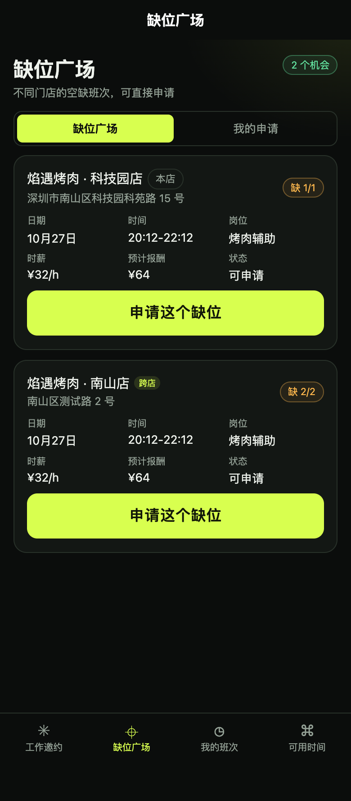

<p align="center">
  
</p>

<h1 align="center">SmartStaff AI · DeepSeek 플러그인</h1>

<p align="center">
  <b>첫 실행 시 DeepSeek API 설정 마법사가 열리는 플러그인형 매장 인력 워크스페이스.</b><br />
  <code>deepseek</code> · <code>deepseek-api</code> · <code>deepseek-plugin</code> · <code>ai-plugin</code> · <code>다국어</code>
</p>

<p align="center">
  
  
  
  
</p>

<p align="center">
  <b>언어:</b> <a href="README.md">EN</a> · <a href="README.zh-CN.md">ZH</a> · <a href="README.ko.md">KO</a> · <a href="README.ja.md">JA</a>
</p>

## 무엇인가요?

SmartStaff AI는 식당 인력 운영을 위한 **테스트 프레임워크 플러그인**입니다. 결정론적 수용량 엔진, DeepSeek 기반 설명 계층, 완성도 높은 관리자 워크스페이스를 결합했습니다.

관리자가 처음 로그인했을 때 자격 증명이 없으면 **DeepSeek API 설정 마법사**가 자동으로 열립니다. Key를 저장하고 실제 연결을 테스트하면 비즈니스 AI도 같은 런타임 설정을 사용합니다.

완성된 상용 제품이 아니라 **설치·검토·확장 가능한 플러그인 프레임워크**입니다.

## 특징

- **첫 실행부터 설정**: 로그인 후 API 마법사가 바로 열립니다.
- **실제 연결 테스트**: 실제 HTTPS 요청으로 상태 코드, JSON, `finish_reason`, 모델, 토큰, 지연 시간을 확인합니다.
- **쓰기 전용 Key**: 원본 Key는 브라우저나 일반 로그로 돌아오지 않습니다.
- **결정론적 코어**: DeepSeek는 설명과 제안만 작성하며 인원수와 하드 제약을 결정하지 않습니다.
- **4개 언어**: 중국어, 영어, 한국어, 일본어를 한 번에 전환합니다.
- **Shadow 안전**: AI 설정은 실제 초대, 근무, 알림, 인건비를 발생시키지 않습니다.


## 아르바이트 공석 마켓

아르바이트 계정은 다른 매장의 공석을 보고 지원하고, 철회하고, 결과를 확인할 수 있습니다. 매장 관리자가 승인하면 동일한 근무 상태 머신으로 확정 근무가 생성됩니다.

자세히: [docs/PART-TIME-MARKETPLACE.md](docs/PART-TIME-MARKETPLACE.md).

<p align="center"></p>


## SaaS 계정 시스템 (1단계)

이메일 가입, 조직 생성, owner 멤버십, 이메일 인증, 이메일 로그인, 비밀번호 재설정을 `/admin/account.html`에 구현했습니다. 이메일 발송은 아직 구성되지 않았습니다. [SAAS-ACCOUNT-SYSTEM.md](SAAS-ACCOUNT-SYSTEM.md) 참고.

## UI

<table>
  <tr>
    <td width="50%"><br /><sub><b>첫 설정 마법사</b> — 미설정 시 로그인 후 자동으로 열립니다.</sub></td>
    <td width="50%"><br /><sub><b>AI 설정</b> — 모델, 시간 초과, 예산, 자격 증명 상태, 사용량.</sub></td>
  </tr>
  <tr>
    <td><br /><sub><b>운영 워크스페이스</b> — 테이블, 대기열, 예측, 예외.</sub></td>
    <td><br /><sub><b>AI 설명</b> — 구조화된 분석이며 인원수를 직접 정하지 않습니다.</sub></td>
  </tr>
</table>

## 설치

```bash
git clone https://github.com/YanKaFei/smartstaff-ai-deepseek-plugin.git
cd smartstaff-ai-deepseek-plugin
npm run setup
npm run build
npm run seed
npm start
```

<http://127.0.0.1:8787/admin/> 를 엽니다.

> `npm run setup`은 서버와 미니프로그램 의존성을 설치합니다. Node.js 24+ 권장.

### 첫 실행

1. 관리자 워크스페이스에 로그인합니다.
2. 자격 증명이 없으면 **DeepSeek 설정 마법사**가 자동으로 열립니다.
3. 모델을 선택하고 Key를 붙여 넣은 뒤 **저장 후 연결 테스트**를 클릭합니다.
4. Key가 없으면 닫아도 됩니다. 결정론적 예측은 계속 동작합니다.

전체 설치 안내: [docs/PLUGIN-INSTALL.md](docs/PLUGIN-INSTALL.md)

## 설정

| 항목 | 기본값 | 비고 |
| --- | --- | --- |
| 제공자 | DeepSeek | 첫 버전만 |
| Base URL | `https://api.deepseek.com` | 공식 주소만 |
| 모델 | `deepseek-flash` | `deepseek-v4-pro` 선택 가능 |
| 시간 초과 | 20초 | 5–60초 |
| AI 스위치 | 사용 | 중지 가능 |
| 매장 일일 예산 | $5 | 추정 |
| 플랫폼 예산 | $80 / 30일 | 추정 |
| 자격 증명 | 미설정 | 쓰기 전용, 서버 암호화 |

요청 시작 시 설정 스냅샷을 한 번 해석합니다. 진행 중인 요청은 기존 스냅샷을 유지하고 다음 요청부터 새 설정을 사용합니다.

## 아키텍처

```text
매장 데이터
   │
   ▼
결정론적 수용량 엔진 ── 하드 제약 / 필요 인원
   │
   ▼
통합 AI 서비스 ──► DeepSeek API ──► JSON / Zod 검증
   │                                      │
   ▼                                      ▼
구조화된 분석                         실패 시 폴백
   │
   ▼
관리자 워크스페이스 / 매니저 UI
```

- DeepSeek는 설명, 제안, 위험 알림만 생성합니다.
- 인원수와 매칭 하드 제약은 결정론적 엔진이 유지합니다.
- AI 실패, 비활성화, 예산 초과 시 매니저 흐름을 멈추지 않고 폴백합니다.

## 보안

- API Key는 AES-256-GCM으로 암호화 (`smartstaff:ai-api-key:v1` AAD).
- Key는 브라우저 `localStorage`, 미니프로그램 저장소, 빌드 산출물, 일반 로그에 들어가지 않습니다.
- 관리자 전용 API이며 민감한 변경은 최근 로그인 재확인이 필요합니다.
- 자격 증명 철회 시 저장된 Key와 환경 변수 폴백을 모두 차단합니다.
- 공식 DeepSeek Base URL만 허용하며 임의 URL은 거부합니다.
- 실제 오류는 `AI_AUTH_FAILED`, `AI_TIMEOUT`, `AI_RESPONSE_INVALID`, `AI_NOT_CONFIGURED`로 매핑됩니다.

## 테스트

```bash
npm test
```

현재 **119/119** 통과. 기존 R5.2의 95개 기준선은 모두 유지되며, 10개 AI, 4개 공석, 5개 계정, 3개 조직 테스트가 자격 증명, RBAC, 공급자 실패, 가입, 인증, 재설정, 초대, 멤버 관리를 검증합니다.

실제 API 성공에는 실제 Key가 필요합니다. Key가 없으면 **REAL_API_BLOCKED**로 표시하며 Mock 연결을 성공이라고 주장하지 않습니다.

## DeepSeek 검색 태그

`deepseek` · `deepseek-api` · `deepseek-plugin` · `deepseek-tools` · `ai-plugin` · `ai-settings` · `llm-plugin` · `openai-compatible` · `restaurant-staffing` · `workforce-management` · `smartstaff` · `multilingual` · `typescript` · `vue3` · `nodejs`

## 향후 가능성

- 플러그인 마켓 패키징과 원클릭 설치.
- 명시적 허용 목록을 통한 추가 DeepSeek 호환 제공자.
- 관리자 UI로의 실시간 스트리밍 분석.
- 식당 POS/대기열 어댑터와 더 깊은 수요 신호.
- 실제 매장 14일 Shadow 평가.
- 공급자 인보이스와 비용 대사.
- 역할 기반 팀 워크스페이스와 감사 내보내기.

## 프로젝트 상태

**테스트 프레임워크 / 상용화 전.** UI, API 설정, 자격 증명 수명주기, DeepSeek 프로브, 결정론적 폴백은 구현 및 테스트되었습니다. 실제 매장 데이터, 실제 매니저 피드백, 프로덕션 인프라는 향후 작업입니다.

## 라이선스

라이선스 미정. 이 저장소는 평가와 확장을 위한 테스트 프레임워크로 공개됩니다.
