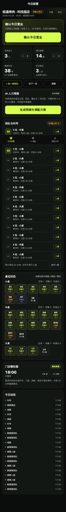

# SmartStaff AI 1.0 + R2

**烤肉门店智能人力调配系统** — 门店经营数据 → 未来 3 小时人力预测 → 自动匹配兼职 → 店长确认 → 兼职接单 → 到店签到 → 完工记录。

一套代码同时交付 **微信小程序（uni-app + Vue 3 + TypeScript）**、**H5 预览**、**Web 管理后台** 和 **Node.js + SQLite API**。1.0 的完整业务闭环已实现；R2 在其上完成安全、候补、服务分钟模型、统一事件摄取与 AI 成本治理。当前 **105 项自动化测试全部通过**（37 项 R1 基线 + 68 项 R2–R6 增量），不是原型或伪代码。

> R2 验收详情与证据见 [`R2-VALIDATION-REPORT.md`](R2-VALIDATION-REPORT.md)。
> R3 试点准备、集成矩阵、安全、校准与试点计划见 [`R3-READINESS-REPORT.md`](R3-READINESS-REPORT.md)。
> R4 影子数据导入、回放、评估与 Gate 见 [`R4-RELEASE-GATE.md`](R4-RELEASE-GATE.md)。
> R5 首店影子工作包与决策见 [`R5-PILOT-DECISION.md`](R5-PILOT-DECISION.md)。
> R5.1 现场工作包见 [`R5.1-FIELD-READINESS.md`](R5.1-FIELD-READINESS.md)。
> R5.2 标签口径修正与首店清单见 [`R5.2-METRIC-VALIDATION.md`](R5.2-METRIC-VALIDATION.md)。
> R6 AI 模型与 API 设置见 [`AI-API-SETTINGS-REPORT.md`](AI-API-SETTINGS-REPORT.md)。


---

## 0. R2 增量（本次）

| 主题 | 结果 |
| --- | --- |
| 身份与安全 | 微信 `code2Session` 入口、OpenID 绑定、店长一次性授权码、兼职手机号核验、管理员强密码/限流、演示登录默认关闭、CORS 白名单、HTTPS、短 access + 轮换 refresh + 敏感操作复验 |
| 取消与候补 | 兼职开始前自助取消；店长可按“个人/整个需求”取消；确认班次取消/缺岗后自动候补；不补超预算/无候选并显式生成异常；被取消班次不保留 `accepted` 终态 |
| 服务模型 | 全程代烤/部分代烤/自主烤制；显式区分物理桌与标准桌当量；新增服务分钟模型与旧算法基线对比；未校准参数降级可靠性；真实样本校准需管理员证据，前端不能自行标记 |
| 事件摄取 | 统一 `event_ingest` 账本；manual/simulator/webhook 适配器；HMAC 签名、幂等、乱序/陈旧、异常、修正与重放；前后台可见数据陈旧状态 |
| AI 治理 | 真实 DeepSeek 成功才标记 ok；记录模型/tokens/延迟/估算成本；单店与全平台预算；缓存去重；错误码脱敏；无 Key 阻塞 |
| 首页 UX | 当前状态、3 小时预测、已接受/已到岗/未填补、异常优先；只保留 3 个主操作（更新营业 / AI 调配 / 处理异常），现场微调收进次级入口 |
| 试点就绪 | Webhook 密钥 AES-256-GCM、共享 DB 限流、SQLite 备份/恢复、POS adapter 契约、影子模式、紧急暂停、校准模板/误差分析；真实外部依赖仍 BLOCKED |


> 说明：真实微信登录、短信、真实 POS 与真实 DeepSeek 成功验收均需要外部凭据。没有凭据时系统明确返回 503/错误码，绝不伪造成功。

---

## 1. 已实现的闭环

| 环节 | 实现 |
| --- | --- |
| 首次配置 | 4 步向导：门店资料 → 桌型/翻台 → 员工与工作量 → 数据来源；永久保存，可随时修改 |
| 每日经营 | 自动恢复上次配置；加减按钮维护在岗/排队；叫号、入座、结账、离店、清台；一键确认营业 |
| 预测引擎 | 独立、确定性的容量引擎，6 个 30 分钟时段；考虑桌型权重、翻台、清台、排队、历史入座与员工产能 |
| AI 解释 | DeepSeek `deepseek-flash` + JSON 输出；只生成解释文本，人数与时段始终由引擎决定；失败自动降级 |
| 自动匹配 | 硬性条件过滤 + 距离/准点率/经验/成本排序；始终生成**经济方案**与**保障方案**；候选不足时如实显示缺口 |
| 店长确认 | 方案对比、查看推荐人员、替换候选人、确认调配；生成真实工作邀约 |
| 兼职接单 | 小程序查看邀约、接受/拒绝；超时未响应自动顺延下一位；无候选时通知店长 |
| 到店与完工 | 签到码/扫码签到、签退、实际工时与预计报酬、店长确认完工 |
| 模拟器 | 8 小/12 中/4 大桌、3 名在岗、14 组排队、叫号 38；7 天历史事件；可加速运行；每 30 分钟重算需求 |
| 管理后台 | 人员审核（培训合格后才能接单）、订单/班次、异常处理、模拟器控制、审计日志 |
| 工程质量 | 三角色权限、门店隔离、状态机 + CAS/事务、Zod 校验、超时降级、结构化日志、并发抢单测试 |

---

## 2. 界面预览

| 店长 · 今日经营 | 店长 · AI 调配方案 | 兼职 · 工作邀约 |
| --- | --- | --- |
|  |  |  |

| 首次配置向导 | 调配记录与签到码 | 管理后台 |
| --- | --- | --- |
|  |  |  |

更多截图见 [`docs/screenshots/`](docs/screenshots/)。

---

## 3. 技术架构

```
┌──────────────── 微信小程序 / H5（uni-app + Vue 3 + TS）────────────────┐
│ 店长端：今日经营 · AI 调配方案 · 调配记录                              │
│ 兼职端：工作邀约 · 我的班次 · 可用时间                                  │
└───────────────────────────────┬─────────────────────────────────────────┘
                                │ JSON / Bearer Session
┌───────────────────────────────▼─────────────────────────────────────────┐
│ Node.js 22+ API（TypeScript，node:http，无框架依赖）                    │
│ auth & RBAC · 经营事件 · 容量预测 · 匹配 · 邀约状态机 · 模拟器 · 审计     │
│         │                                   │                           │
│         │ node:sqlite（开发库）             └──▶ DeepSeek API（可选）    │
│         ▼                                       仅解释，不产生人数        │
│   SQLite 文件 / 可迁移 PostgreSQL                                        │
└───────────────────────────────┬─────────────────────────────────────────┘
                                │ 静态文件
                     ┌──────────▼──────────┐
                     │ Web 管理后台（原生） │
                     └─────────────────────┘
```

设计要点：

- **人数不由 LLM 决定**。`domain/capacity.ts` 是纯函数式确定性引擎；DeepSeek 只能按给定 `slotIndex` 写解释。后端校验 JSON 结构与数值，人数/时段一律用引擎结果覆盖。
- **单一业务时钟**。门店可被模拟器偏移时钟；`storeNow()` 是所有业务操作的唯一时间源，邀约超时、迟到、缺席都按模拟时间推进。
- **事件驱动**。叫号、入座、结账、离店、清台都写入 `ops_events` 与对应的会话/队列表；预测只读取“当前时刻之前”的数据。
- **不引入微服务**。单进程、单 SQLite 文件，先保证可运行与可演示；所有 SQL 保持可迁移风格。

---

## 4. 目录结构

```
SmartStaff-AI/
├── apps/
│   ├── server/                 # Node.js + TypeScript API
│   │   ├── src/
│   │   │   ├── ai/deepseek.ts  # DeepSeek 调用、校验、确定性降级
│   │   │   ├── db/             # SQLite schema / 连接 / 迁移入口
│   │   │   ├── domain/         # 预测、匹配、派单、经营、模拟器、门店
│   │   │   ├── lib/            # HTTP、认证、校验、时间、日志
│   │   │   ├── routes/         # auth / manager / staff / admin
│   │   │   ├── app.ts
│   │   │   ├── index.ts
│   │   │   └── seed.ts         # 模拟数据：14 名兼职 + 7 天事件
│   │   ├── tests/              # 105 项 node:test 自动化测试
│   │   ├── data/               # smartstaff.db（seed 生成）
│   │   └── .env.example
│   ├── miniapp/                # uni-app Vue3 + TS
│   │   ├── src/pages/
│   │   │   ├── login/
│   │   │   ├── manager/        # setup / home / plans / records
│   │   │   └── staff/          # offers / shifts / availability
│   │   ├── src/api/            # 请求、类型、格式化
│   │   └── dist/build/         # h5 与 mp-weixin 构建产物
│   └── admin/                  # 管理后台静态站点（由 API 托管）
├── docs/
│   ├── TEST-REPORT.md
│   ├── test-output.txt
│   ├── API.md
│   └── screenshots/
├── package.json
├── README.md
└── （环境变量模板：apps/server/.env.example）
```

---

## 5. 快速开始

### 环境要求

- Node.js **22.5+**（项目使用内置 `node:sqlite`；在 Node 24.19 上验证）
- npm 10+
- 微信开发者工具（仅预览小程序时需要）

### 安装与启动

```bash
cd SmartStaff-AI
npm run setup          # 安装 server + miniapp 依赖
npm run seed           # 生成模拟数据库（需要重置时用 npm --prefix apps/server run reset）
npm run dev            # 启动 API，默认 http://127.0.0.1:8787
```

已有数据库时直接 `npm run dev`。若数据库为空，服务首次启动会自动执行 seed。

打开：

- H5 预览：<http://127.0.0.1:8787/app/>
- 管理后台：<http://127.0.0.1:8787/admin/>
- 健康检查：<http://127.0.0.1:8787/health>

### R2 新增环境变量

```bash
# 身份与安全
ALLOW_DEMO_LOGIN=false
RATE_LIMIT_BACKEND=db
SECRET_ENCRYPTION_KEY=
CORS_ORIGINS=https://your-admin.example.com
REQUIRE_HTTPS=true
TRUST_PROXY=true
ACCESS_TOKEN_TTL_MINUTES=120
REFRESH_TOKEN_TTL_DAYS=30
SENSITIVE_REAUTH_MINUTES=15
# 微信 / 短信（未配置则对应功能返回 503）
WECHAT_APPID=
WECHAT_SECRET=
SMS_PROVIDER=
SMS_API_KEY=
# DeepSeek 治理
DEEPSEEK_INPUT_PRICE_PER_MTOK=0.27
DEEPSEEK_OUTPUT_PRICE_PER_MTOK=1.1
DEEPSEEK_DAILY_BUDGET_USD=5
DEEPSEEK_MONTHLY_BUDGET_USD=80
DEEPSEEK_CACHE_TTL_MINUTES=30
```

开发环境可显式设置 `ALLOW_DEMO_LOGIN=true` 和 `ADMIN_PASSWORD` 以使用演示账号；生产启动会拒绝演示登录、弱/默认管理员密码、通配 CORS 与非 HTTPS（见 `assertProductionSafety`）。

### 演示账号

| 角色 | 登录方式 | 说明 |
| --- | --- | --- |
| 店长 | 门店编码 `K001` | 焰遇烤肉 · 科技园店 |
| 兼职 | 手机号 `13800000001` | 林小雨，已审核、已培训 |
| 兼职 | `13800000002` ~ `13800000014` | 不同技能/距离/时段/状态 |
| 管理员 | 本地 `.env` 显式设置的密码 | 代码无默认密码；生产必须配置强密码 |

> 认证说明：R2 已实现真实 `wx.login` → `code2Session` → OpenID 绑定；未配置 AppID/Secret 时返回 503，不伪造。演示登录仅在非生产、显式开启且回环地址可用。真实微信成功验证仍需合法凭据与真机 code；详见 `R3-INTEGRATION-MATRIX.md`。

### 生产式启动

```bash
npm run build          # TypeScript 编译到 apps/server/dist
npm run start          # node dist/index.js
```

### 小程序构建与导入

```bash
npm run build:miniapp  # uni-app 构建 mp-weixin
```

1. 打开微信开发者工具 → 导入项目。
2. 目录选择 `apps/miniapp/dist/build/mp-weixin`。
3. 使用测试号 `touristappid` 可直接预览；正式发布请在 `apps/miniapp/src/manifest.json` 改为自己的 AppID。
4. 本地联调时，在开发者工具中勾选「不校验合法域名、web-view（业务域名）、TLS 版本以及 HTTPS 证书」；构建产物已设置 `urlCheck: false`。
5. 真机或远程调试时，把 API 部署到 HTTPS 域名，并设置构建环境变量 `VITE_API_BASE=https://your-domain/api` 后重新构建。

H5 构建：`npm run build:h5`，产物位于 `apps/miniapp/dist/build/h5`，API 服务会在 `/app/` 托管它。

### 根目录脚本

| 命令 | 作用 |
| --- | --- |
| `npm run setup` | 安装两个子项目依赖 |
| `npm run dev` | 启动 API（tsx watch） |
| `npm run seed` | 生成/补齐演示数据 |
| `npm run build` | 编译 server |
| `npm run start` | 运行编译后的 server |
| `npm run test` | 105 项自动化测试 |
| `npm run reset` | 删除并重建模拟数据库 |
| `npm run build:all` | 构建 server + H5 + 微信小程序 |
| `npm run dev:h5` | uni-app H5 开发服务器（5173，/api 代理到 8787） |
| `npm run verify` | 测试 + 全量构建 |
| `npm run build:h5` | 构建 H5 |
| `npm run build:miniapp` | 构建微信小程序 |

---

## 6. 配置项（后端）

复制 `apps/server/.env.example` 为 `apps/server/.env`：

```ini
PORT=8787
HOST=0.0.0.0
NODE_ENV=development
DATABASE_PATH=                 # 留空使用 apps/server/data/smartstaff.db
# 生产不要使用默认值；以下仅为本地示例
ADMIN_PASSWORD=
SECRET_ENCRYPTION_KEY=
RATE_LIMIT_BACKEND=db
ACCESS_TOKEN_TTL_MINUTES=120
REFRESH_TOKEN_TTL_DAYS=30
ALLOW_DEMO_LOGIN=false
CORS_ORIGINS=https://your-admin.example.com
REQUIRE_HTTPS=true

DEEPSEEK_API_KEY=              # 仅保存在后端；不要提交
DEEPSEEK_BASE_URL=https://api.deepseek.com
DEEPSEEK_MODEL=deepseek-flash
DEEPSEEK_TIMEOUT_MS=12000

# 预留：微信订阅消息（1.0 未启用）
WECHAT_APPID=
WECHAT_SECRET=
WECHAT_OFFER_TEMPLATE_ID=
```

- **未配置 `DEEPSEEK_API_KEY`**：预测、匹配、派单、签到和模拟器全部照常运行，AI 摘要使用确定性模板（界面显示「确定性引擎降级」）。
- **配置了但调用失败/超时/返回非法 JSON**：同样回退，不阻塞业务。
- DeepSeek Key 只存在于服务端；前端没有任何模型密钥。

---

## 7. 演示完整闭环

1. 店长用 `K001` 登录，首页自动恢复在岗 3 人、24 张桌、14 组排队、最新叫号 38。
2. 点「确认今日营业」（无需重复填写）。
3. 点「生成预测与调配方案」。系统计算未来 3 小时需求（示例缺口 5 人），生成经济方案与保障方案。
4. 点「确认调配并发起邀约」，5 份邀约进入待接受状态。
5. 用兼职 `13800000001` 登录，在「工作邀约」接受。
6. 在「我的班次」输入签到码 `K001`（或扫码）签到。
7. 店长在首页点「+1 小时」，模拟器写入叫号/入座/结账/离店/清台事件，自动重算需求；兼职签退后店长「确认完工」。
8. 管理后台可审核待审核兼职、查看邀约/异常、观察模拟器时钟与每 30 分钟预测。

异常演示：

- **拒绝/超时**：不接受的邀约在 10 分钟后自动过期并顺延给下一位；无人可接时生成 `no_candidate` 异常通知店长。
- **多人抢单**：同一邀约并发接受只有一人成功，另一请求返回 409。
- **无可用人员**：在后台暂停所有兼职，再生成方案，会显示缺口且禁止确认空方案。
- **AI 故障**：清空 Key 或填写错误地址，预测仍返回确定性结果。

---

## 8. 预测引擎（确定性）

实现见 [`apps/server/src/domain/capacity.ts`](apps/server/src/domain/capacity.ts)。

- **预测窗口**：从下一个 30 分钟整点起，6 个时段、共 3 小时。
- **桌位可用时间**：用餐中 = `seated_at + 平均用餐 + 结账至离店 + 离店至清台`；已结账至少还要经过离店与清台；清台完成才可复用。结账不等于可再次入座。
- **到达率**：最近 2 小时实际入座率（每 30 分钟）与 7 天同时段历史均值各占 50%；没有历史时用桌位数 × 0.32 的保守值。最近叫号次数会记录为预测数据点，但**不会**被直接换算成入座或增派人数。
- **工作量**：`Σ(在用桌数 × 桌型权重) + 排队组数 × 0.2`；需求人数 = `ceil(工作量 ÷ 每人可负责桌数 × (1 + 缓冲%))`。
- **缺口**：`max(0, 需求 - 在岗)`；连续缺口时段合并为一个可执行班次。
- **瓶颈**：桌位饱和且排队、而人员产能足够 → **桌位瓶颈**，优先建议加快翻台；人员产能不足 → **人员瓶颈**，才建议增派。
- **可靠性**：依据最近 2 小时样本量与历史天数，输出 high/medium/low 及原因。
- **关键防呆**：人力充足时不建议增派；不会因为排队变长机械加人；没有候选时方案缺口如实显示。

DeepSeek 只按下面的 JSON 结构返回解释，`slotIndex` 越界或字段缺失会被 Zod 拒绝：

```json
{
  "summary": "……",
  "riskLevel": "low | medium | high",
  "bottleneckExplanation": "……",
  "slotNotes": [{ "slotIndex": 0, "note": "……" }],
  "cautions": ["……"]
}
```

---

## 9. 匹配与派单

硬性条件（任一不满足即淘汰）：

1. 审核通过；2. 岗位培训合格（可按门店配置关闭）；3. 可用时间完整覆盖班次；4. 与已有 `invited/confirmed/checked_in` 班次不重叠；5. 距离 ≤ 门店上限；6. 满足最短通知时间且能按路程准时到店。

排序：

- **经济方案**：期望时薪优先 → 距离 → 准点率。
- **保障方案**：准点率、经验、培训与距离优先 → 成本。

邀约状态机：

```
pending ──accept──▶ accepted  → shift confirmed → checked_in → completed
   │
   ├──reject──▶ rejected ─┐
   ├──timeout─▶ expired  ─┼─▶ 尝试下一位候选 ──▶ 新 offer(pending, attempt+1)
   └──manager cancel──────┘                     └─▶ 无候选：shift cancelled + 异常 + 通知店长
```

并发控制：接受邀约使用 `UPDATE ... WHERE status='pending'` 的 CAS；接受前再次检查同人班次冲突；SQLite `BEGIN IMMEDIATE` 事务保证方案确认、派单、签到等复合操作原子性。

---

## 10. 数据模型（SQLite）

`apps/server/src/db/schema.ts` 包含完整 DDL 与索引：

- `users / sessions / stores / store_config(json) / store_clocks`
- `store_tables / dining_sessions / queue_entries / ops_events / business_days`
- `staff_profiles / staff_availability`
- `forecasts / assignment_plans / job_offers / shifts`
- `notifications / exceptions / audit_logs`

约定：所有业务时间均为 epoch 毫秒；营业日使用 `Asia/Shanghai` 固定时区，支持跨午夜（`business_date` 归属前一日）。

---

## 11. API 摘要

完整清单与示例见 [`docs/API.md`](docs/API.md)。

- 认证：`POST /api/auth/mini-login`、`/register-store`、`/admin-login`；`GET /api/me`
- 店长：`/api/manager/today`、`/today/confirm`、`/ops`、`/forecast`、`/plans`、`/plans/:id/confirm`、`/plans/:id/replace`、`/assignments`、`/exceptions`、`/sim/advance`
- 兼职：`/api/staff/me`、`/me/availability`、`/offers`、`/offers/:id/accept|reject`、`/shifts`、`/shifts/:id/checkin|checkout`
- 管理：`/api/admin/overview`、`/staff`、`/staff/:id/review`、`/shifts`、`/exceptions`、`/sim/control`、`/logs`

统一响应：`{ "ok": true, "data": ... }` / `{ "ok": false, "error": { "code", "message" } }`。

---

## 12. 测试与验收

当前：`npm test` → 105/105 通过（37 项 R1 基线 + 68 项 R2–R6）。证据在 `docs/r6-evidence/`。

```bash
cd SmartStaff-AI
npm test
```

**105 项全部通过**（详见 [`R4-RELEASE-GATE.md`](R4-RELEASE-GATE.md)、[`AI-API-SETTINGS-REPORT.md`](AI-API-SETTINGS-REPORT.md) 与原始输出 [`docs/r6-evidence/test-output-r6.txt`](docs/r6-evidence/test-output-r6.txt)）：

- 容量引擎：人力充足零建议、连续缺口合并、桌位瓶颈、结账不清空桌位、历史到达率
- 匹配：审核/培训/时间/冲突/距离/通知时间硬过滤、跨午夜、双方案差异、缺口不虚构、防重复派单
- 全链路：确认营业 → 预测 → 方案 → 邀约 → 接单 → 签到 → 加速模拟 → 签退 → 店长确认
- 异常：拒单顺延、超时顺延、无候选、空方案禁止确认、AI 密钥缺失/超时/HTTP 500/非法 JSON 降级
- 并发与安全：抢单 CAS、跨用户 403、跨角色 403、未登录 401、错误密码、输入校验、门店隔离
- 管理：培训前禁止审核通过、培训→通过流程
- 新门店：创建 → 配置 → 完成引导 → 数据隔离

构建验证：`npm run build`、`npm run build:h5`、`npm run build:miniapp` 均成功；H5/后台已用无头 Chrome 走通主要页面，控制台无报错。

---

## 13. 安全与生产注意事项

已落实：

- 店长 / 兼职 / 管理员 RBAC；店长与兼职所有查询按 `store_id` / `staff_id` 限定。
- 会话为 Access + Refresh Token，只存 SHA-256 摘要；Access 默认 120 分钟、Refresh 30 天，轮换/撤销/敏感操作复验。
- 全部写接口 Zod 校验；AI 输出二次校验。
- 状态机 + CAS + 事务；重复接单/重叠派单被拒绝。
- DeepSeek 12 秒超时、异常降级；请求结构化日志、审计日志、异常表。

上线前仍需：

1. 配置真实微信 AppID/Secret、短信服务商、POS 厂商凭据与 DeepSeek Key；当前均 BLOCKED，详见 R3 集成矩阵。
2. 生产启用 HTTPS、显式 CORS 白名单、强管理员密码、`SECRET_ENCRYPTION_KEY` 与共享限流；完成 PostgreSQL/多实例/备份演练。
3. 用 PostgreSQL 替换 SQLite（schema 可按文件迁移），执行备份与迁移演练。
4. 落实劳动/劳务关系、报酬结算、保险、个人信息保护（PIPL）、未成年人用工与相关许可。
5. 1.0 **不包含真实支付、自动扣款或资金划拨**；只记录预计报酬与实际工时。

---

## 14. 验收对照

| 验收项 | 状态 | 位置 |
| --- | --- | --- |
| 创建烤肉店 → 首次配置 → 次日恢复 → 确认营业 | ✅ | 向导 `/pages/manager/setup`；`store_config` 持久化 |
| 模拟器产生叫号/入座/结账/离店/清台 | ✅ | `domain/simulator.ts`、`ops_events` |
| 计算未来 3 小时人力缺口 | ✅ | `domain/capacity.ts` |
| DeepSeek 解释并生成建议 | ✅ | `ai/deepseek.ts`（无 Key 自动降级） |
| 自动筛选可用兼职，两种方案 | ✅ | `domain/matching.ts`、`domain/plans.ts` |
| 店长选择方案 → 兼职接单 → 签到 → 完工 | ✅ | `domain/dispatch.ts` + 小程序页面 |
| 无可用兼职 / 多人抢单 / 拒单 / API 失败 | ✅ | 自动化测试覆盖 |
| 完整源码、README、启动命令、模拟库、测试报告、小程序工程 | ✅ | 本仓库 + `docs/` + `dist/build/mp-weixin` |

---

## 15. 许可与声明

本项目为 SmartStaff AI 1.0 演示与工程基线。演示数据中的门店、兼职人员与事件均为模拟生成，不代表真实个人或门店。商用前请完成上节所列合规与安全事项。
