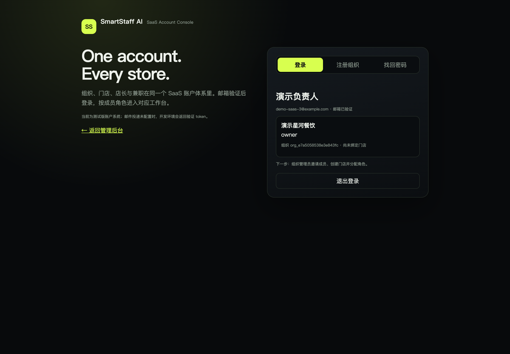
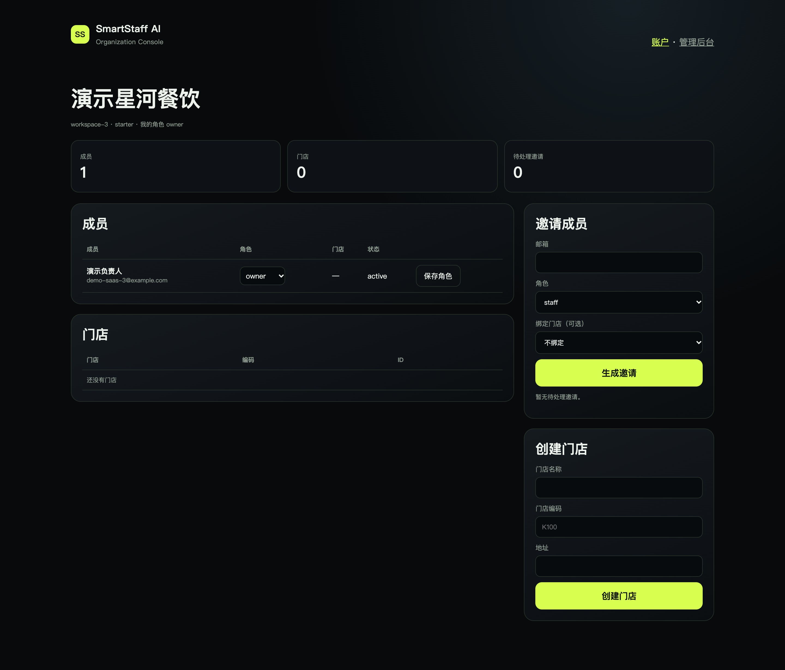

<p align="center">
  
</p>

<h1 align="center">SmartStaff AI</h1>

<p align="center">
  <b>面向餐饮门店的多租户人力 SaaS，带 DeepSeek 经营分析层。</b><br />
  <code>deepseek</code> · <code>餐饮排班</code> · <code>多租户</code> · <code>SaaS</code> · <code>兼职缺位广场</code>
</p>

<p align="center">
  
  
  
  
</p>

<p align="center">
  <b>语言：</b> <a href="README.md">EN</a> · <a href="README.zh-CN.md">中文</a> · <a href="README.ko.md">KO</a> · <a href="README.ja.md">JA</a>
</p>

## 这是什么？

SmartStaff AI 是一个**测试版餐饮门店人力 SaaS 框架**，把以下能力放在同一套系统里：

- 组织、门店、店长、兼职的多租户账户体系；
- 跨门店兼职缺位广场与申请/审批工作流；
- 确定性人力预测引擎；
- DeepSeek 经营分析解释层，不改变硬性人数约束；
- 带首次 API 配置向导的管理后台。

它是**测试框架**，不是完成商业产品；目的是让团队安装、审查、评估并继续扩展。

## 产品模块

| 模块 | 作用 |
| --- | --- |
| **SaaS 账户** | 邮箱注册、验证、登录、重置密码、组织、成员、角色和邀请。 |
| **组织控制台** | Owner/Admin 管理成员、角色、门店、邀请、所有权转移和首店。 |
| **兼职缺位广场** | 兼职查看组织内不同门店的开放缺位，申请、撤回、查看结果。 |
| **店长审批** | 店长审核申请，通过后生成 confirmed 班次并回填缺位。 |
| **AI 人力预测** | 确定性预测 + DeepSeek 解释 + 结构化 JSON 校验。 |
| **DeepSeek 配置** | 首次 API 向导、加密只写 Key、模型/超时/预算、真实连接测试和用量。 |
| **Shadow 安全** | AI 配置和缺位申请不会绕过影子/暂停门禁创建真实班次。 |

## 界面

<table>
  <tr>
    <td width="50%"><br /><sub><b>账户控制台</b> — 组织、成员身份、会话。</sub></td>
    <td width="50%"><br /><sub><b>组织管理</b> — 成员、邀请、门店。</sub></td>
  </tr>
  <tr>
    <td><br /><sub><b>兼职缺位广场</b> — 跨店开放缺位与申请。</sub></td>
    <td><br /><sub><b>DeepSeek 首次配置</b> — 配置并测试真实 API 连接。</sub></td>
  </tr>
</table>

## 快速开始

```bash
git clone https://github.com/YanKaFei/smartstaff-ai-deepseek-plugin.git
cd smartstaff-ai-deepseek-plugin
npm run setup
npm run build
npm run seed
npm start
```

- 管理后台：<http://127.0.0.1:8787/admin/>
- SaaS 账户：<http://127.0.0.1:8787/admin/account.html>
- 组织控制台：<http://127.0.0.1:8787/admin/org.html>
- H5：<http://127.0.0.1:8787/app/>

建议 Node.js 24+。完整安装说明：[docs/PLUGIN-INSTALL.md](docs/PLUGIN-INSTALL.md)。

## SaaS 账户流程

1. 使用邮箱 + 组织名称注册。
2. 验证邮箱（开发 token 或已配置邮件服务）。
3. 登录并进入账户/组织控制台。
4. 邀请 `admin` / `manager` / `staff` 成员。
5. 在组织内创建门店。
6. Owner 进入门店，或分配给店长。
7. 店长发布缺位，兼职通过广场申请。

邮件通过 outbox + Resend 适配器实现。没有 `RESEND_API_KEY`、`EMAIL_FROM` 和已验证发件域名时，状态为 `PROVIDER_NOT_CONFIGURED`，不会声称已发送。

## DeepSeek 配置

管理员首次登录且未配置凭据时自动打开 API 向导。

- Base URL：`https://api.deepseek.com`
- 模型：`deepseek-flash`、`deepseek-v4-pro`
- Key：AES-256-GCM 服务端加密，只写不读
- 真实 HTTPS 测试：状态码、JSON、`finish_reason`、模型、token、延迟
- 稳定错误：`AI_AUTH_FAILED`、`AI_TIMEOUT`、`AI_RESPONSE_INVALID`、`AI_NOT_CONFIGURED`
- AI 失败、停用或预算用尽时自动降级到确定性预测

## 架构

```text
组织 / 成员 / 门店
        │
        ▼
兼职缺位广场 ── 申请 ──► 店长审批 ──► confirmed 班次
        │
        ▼
确定性容量引擎 ── 硬性人数约束
        │
        ▼
统一 AI Service ──► DeepSeek API ──► JSON + Zod 校验
        │
        ▼
结构化解释 / 店长端
```

## 租户与安全

- 店长访问门店必须有该门店组织的 active membership。
- 兼职路由要求 active staff membership。
- 缺位广场按兼职所属组织过滤。
- Owner/Admin 可邀请、暂停、转移所有权和创建门店。
- 会话记录 UA/IP，可撤销其他设备。
- 账户、组织、邀请、会话、AI 变更均有审计。
- 影子模式或暂停门店不能通过审批创建真实班次。

## 测试

```bash
npm test
```

当前 **124/124** 通过。

原 109 项基线全部保留；新增测试覆盖账户注册/验证/重置、邀请、组织角色、租户隔离、所有权转移、会话管理、邮件 outbox 和兼职市场流程。

证据：[docs/r8-evidence/test-output-r8.txt](docs/r8-evidence/test-output-r8.txt)

## 当前限制

- **真实邮件 Provider 未配置**：生产验证/邀请/重置投递被阻塞；开发 token 可用。
- 旧手机号演示账号需要执行账号合并/邮箱绑定；迁移脚本已存在，但未对真实门店执行。
- 套餐/账单未实现；`plan` 只是数据字段。
- 生产 PostgreSQL/KMS/多实例/监控仍是后续工作。
- 真实门店试点数据、真实店长反馈仍待补充。

## DeepSeek / 搜索标签

`deepseek` · `deepseek-api` · `deepseek-plugin` · `ai-plugin` · `restaurant-staffing` · `workforce-management` · `multi-tenant-saas` · `part-time-marketplace` · `shift-scheduling` · `nodejs` · `typescript` · `vue3` · `multilingual`

## 路线图

- 接入真实邮件服务并完成 SPF/DKIM 验收。
- 旧手机号账号与邮箱账号合并。
- 完成 Owner 首店配置向导。
- 成员移除后的数据归档策略。
- 套餐与账单。
- 生产部署加固与真实门店试点。

## 许可证

许可证待定。作为测试框架发布，供评估和扩展。
