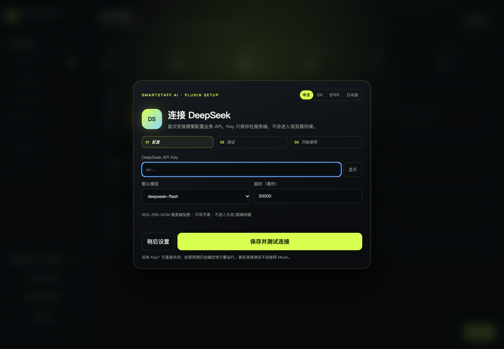
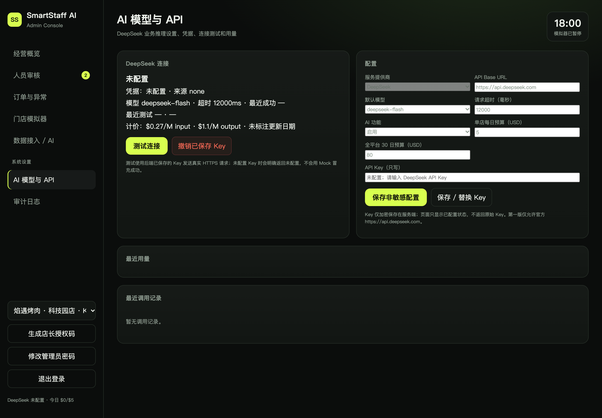
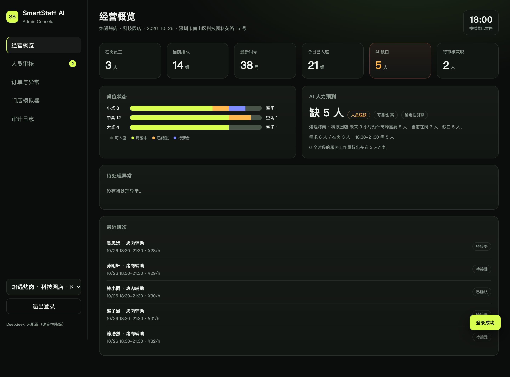
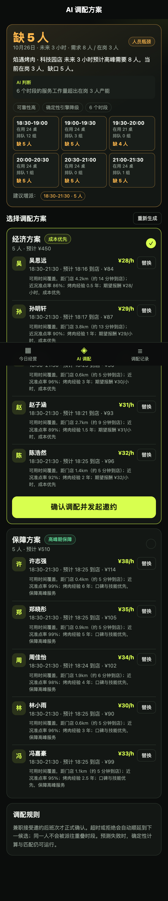

<p align="center">
  
</p>

<h1 align="center">SmartStaff AI · DeepSeek 插件</h1>

<p align="center">
  <b>一个带首次运行 DeepSeek API 配置向导的插件式门店人力工作台。</b><br />
  <code>deepseek</code> · <code>deepseek-api</code> · <code>deepseek-plugin</code> · <code>ai-plugin</code> · <code>多语言</code>
</p>

<p align="center">
  
  
  
  
</p>

<p align="center">
  <b>语言：</b> <a href="README.md">EN</a> · <a href="README.zh-CN.md">中文</a> · <a href="README.ko.md">한국어</a> · <a href="README.ja.md">日本語</a>
</p>

> **中文一句话简介：** SmartStaff AI 是一个可安装的 DeepSeek 插件式门店人力预测与 API 设置框架，首次启用即引导配置并测试连接。

## 这是什么？

SmartStaff AI 是一个面向烤肉店/餐饮门店的**测试版插件框架**，由确定性人力预测引擎、DeepSeek 经营分析解释层和一套完整的管理工作台组成。

管理员首次登录且未配置凭据时，会自动弹出 **DeepSeek API 设置向导**。填入 Key、保存并测试连接后，业务 AI 会使用同一套运行时配置。

它不是完成品，而是一个**可安装、可检查、可扩展的插件框架**，重点是把 DeepSeek 接入、首次配置体验和门店人力流程做清楚。

## 特点

- **首次运行即配置**：登录后直接弹出 API 向导，不用翻找隐藏设置。
- **真实连接测试**：真实 HTTPS 请求，检查状态码、JSON、`finish_reason`、模型、tokens 和延迟。
- **Key 只写不读**：原始 Key 不返回浏览器，不进入普通日志。
- **确定性核心**：DeepSeek 只写解释和建议，不决定人数和硬约束。
- **四语配置**：中文、English、한국어、日本語 一键切换。
- **Shadow 安全**：AI 配置不会触发真实邀约、班次、通知或用工费用。

## 界面

<table>
  <tr>
    <td width="50%"><br /><sub><b>首次配置向导</b> — 未配置时登录自动弹出。</sub></td>
    <td width="50%"><br /><sub><b>AI 设置</b> — 模型、超时、预算、凭据状态和用量。</sub></td>
  </tr>
  <tr>
    <td><br /><sub><b>经营工作台</b> — 桌位、排队、预测和异常。</sub></td>
    <td><br /><sub><b>AI 解释</b> — 结构化分析，不直接给人数。</sub></td>
  </tr>
</table>

## 安装

```bash
git clone https://github.com/YanKaFei/smartstaff-ai-deepseek-plugin.git
cd smartstaff-ai-deepseek-plugin
npm run setup
npm run build
npm run seed
npm start
```

打开 <http://127.0.0.1:8787/admin/>。

> `npm run setup` 会安装服务端和小程序依赖；建议 Node.js 24+。

### 首次启动

1. 登录管理后台。
2. 未配置凭据时自动弹出 **DeepSeek 设置向导**。
3. 选择模型，粘贴 Key，点击 **保存并测试连接**。
4. 没有 Key 可以关闭；确定性预测仍然运行。

完整安装说明：[docs/PLUGIN-INSTALL.md](docs/PLUGIN-INSTALL.md)

## 配置

| 配置项 | 默认值 | 说明 |
| --- | --- | --- |
| 提供商 | DeepSeek | 第一版仅支持 |
| Base URL | `https://api.deepseek.com` | 仅官方地址 |
| 默认模型 | `deepseek-flash` | 可选 `deepseek-v4-pro` |
| 超时 | 20 秒 | 5–60 秒 |
| AI 开关 | 启用 | 可停用 |
| 单店每日预算 | $5 | 估算 |
| 平台预算 | $80 / 30 天 | 估算 |
| 凭据 | 未配置 | 只写、服务端加密 |

每个请求开始时解析一次配置快照；在途请求继续使用旧快照，下一次请求才使用新配置。

## 架构

```text
门店数据
   │
   ▼
确定性容量引擎 ── 硬约束 / 所需人数
   │
   ▼
统一 AI Service ──► DeepSeek API ──► JSON / Zod 校验
   │                                      │
   ▼                                      ▼
结构化经营分析                       失败时降级
   │
   ▼
管理工作台 / 店长端
```

- DeepSeek 只生成解释、建议和风险提示。
- 人数、匹配和硬约束仍由确定性引擎控制。
- AI 失败、停用或预算用尽时自动降级，不阻断店长流程。

## 安全

- API Key 使用 AES-256-GCM 加密（AAD `smartstaff:ai-api-key:v1`）。
- Key 不进入浏览器 `localStorage`、小程序存储、构建产物或普通日志。
- 仅管理员可访问；敏感操作要求最近登录复验。
- 撤销凭据会同时阻断已保存 Key 和环境变量回退。
- 仅允许官方 DeepSeek Base URL，任意地址会被拒绝。
- 真实错误映射为稳定代码：`AI_AUTH_FAILED`、`AI_TIMEOUT`、`AI_RESPONSE_INVALID`、`AI_NOT_CONFIGURED`。

## 测试

```bash
npm test
```

当前 **105/105** 通过。原 R5.2 的 95 项基线全部保留；新增 10 项 AI 设置测试覆盖凭据生命周期、RBAC、401、超时、非法 JSON、结构校验失败、AI 停用、预算/用量和撤销。

真实 API 成功需要真实 Key。没有 Key 时项目会明确标记 **REAL_API_BLOCKED**，绝不声称 Mock 连接成功。

## DeepSeek 搜索标签

`deepseek` · `deepseek-api` · `deepseek-plugin` · `deepseek-tools` · `ai-plugin` · `ai-settings` · `llm-plugin` · `openai-compatible` · `restaurant-staffing` · `workforce-management` · `smartstaff` · `multilingual` · `typescript` · `vue3` · `nodejs`

## 未来可能性

- 插件市场打包与一键安装。
- 更多 DeepSeek 兼容供应商，但必须经过地址白名单。
- 实时流式经营分析。
- 餐饮 POS/叫号系统适配与更丰富需求信号。
- 真实门店 14 天影子评估。
- 供应商账单对账。
- 团队工作区与审计导出。

## 项目状态

**测试版框架 / 非商业成品。** UI、API 设置、凭据生命周期、DeepSeek 探测和确定性降级已实现并测试。真实门店数据、真实店长反馈和生产级基础设施仍是后续工作。

## 许可证

许可证待定。本仓库作为测试框架发布，供评估和扩展。
